# 🥇 Exercises XP Gold

<div align="center">




</div>

A posts API where the interesting part is the middleware: one runs on every request, two guard single routes, and two sit at the end for 404s and errors.

## ▶️ How to run

```bash
npm install
cp .env.example .env   # set API_KEY to any value
npm run dev
```

Sample requests and what the server answered when I ran it (with `API_KEY=secret123`):

```bash
curl -X POST -H "Content-Type: application/json" -d '{"title":"Hi"}' http://localhost:3000/posts
curl -X DELETE http://localhost:3000/posts/1
curl -X DELETE -H "x-api-key: secret123" http://localhost:3000/posts/1
curl http://localhost:3000/broken
```

```
{"errors":["title must have at least 3 characters","content is required"]}
{"error":"Missing or wrong x-api-key header"}
{"message":"Post deleted"}
{"error":"Something broke on purpose"}
```

The terminal shows one line per request, for example `POST /posts -> 400 (1 ms)`.

## 🎯 The challenge

| Middleware | Where it runs | What it does |
|---|---|---|
| `requestTime` | every request | Saves `req.requestTime`, logs method, URL, status and milliseconds when the response finishes |
| `validatePost` | `POST` and `PUT /posts` | Returns 400 with a list of errors when `title` or `content` is wrong |
| `checkApiKey` | `DELETE /posts/:id` | Returns 401 unless the `x-api-key` header equals `API_KEY` |
| `notFound` | after all routes | JSON 404 for unknown URLs |
| `errorHandler` | last | Catches thrown errors and `next(error)`, uses `err.status` or 500 |

`GET /time` shows the value `requestTime` added, and `GET /broken` throws on purpose to test the error handler.

## 🧠 What I learned

- A route can take several functions: `router.post("/", validatePost, createPost)` runs them left to right
- `res.on("finish")` is the place to log the final status code, because it is not known before the handler runs
- `next(error)` skips the normal handlers and jumps straight to the four-argument error handler
- The API key comes from `.env` through `dotenv`, so the real value never goes into the code
- `express-rate-limit` is one more global middleware: it allows each IP 100 requests per 15 minutes and answers 429 after that

---

## 👤 Author

**Kevin Cusnir 'Lirioth'**  
Repository: [Fullstack2026](https://github.com/LiriothTeltanion/Fullstack2026)  
Week 7 Day 1 - Routes, Controllers and Middleware - Exercises XP Gold

## Blog post contract and verification

The in-memory blog exposes `title`, `content` and an ISO 8601 `timestamp` on
seeded and newly created posts. The timestamp records creation and stays unchanged
when a post is updated. Restarting the server restores the original seed data.
The middleware examples above remain available alongside the blog routes.

Run `npm test` after installing dependencies. The regression starts the actual
Express server on a temporary local port and exercises list, create, retrieve,
update and delete, timestamp preservation, invalid input, missing records and the
DELETE authorization guard. It uses a fictional local key and no external service.
