# 🎛️ Controllers - Exercises XP Gold

The request handlers for Exercises XP Gold.

## Contents

- [`postsController.js`](postsController.js)

---

## 👤 Author

**Kevin Cusnir 'Lirioth'**  
Repository: [Fullstack2026](https://github.com/LiriothTeltanion/Fullstack2026)  
Week 7 Day 1 - Routes, Controllers and Middleware - Exercises XP Gold
