# 🧱 Middleware - Exercises XP Gold

The Express middleware for Exercises XP Gold.

## Contents

- [`checkApiKey.js`](checkApiKey.js)
- [`errorHandler.js`](errorHandler.js)
- [`notFound.js`](notFound.js)
- [`requestTime.js`](requestTime.js)
- [`validatePost.js`](validatePost.js)

---

## 👤 Author

**Kevin Cusnir 'Lirioth'**  
Repository: [Fullstack2026](https://github.com/LiriothTeltanion/Fullstack2026)  
Week 7 Day 1 - Routes, Controllers and Middleware - Exercises XP Gold
