# 🥷 Exercises XP Ninja

<div align="center">




</div>

## 👋 Emoji greeting form

Open `/` to make a greeting: enter your name, choose one of six emoji, and select **Make my greeting**. The browser posts to the local Express server and displays a plain-text response. Native radio inputs support keyboard selection, every option has a readable name, and the result and errors are announced through live regions.

The original users API remains available at `/users`. For the Ninja tier I wrote my own rate limiter instead of installing one, then built a users API with query filters, paging and `router.param()`.

## ▶️ How to run

```bash
npm ci
npm start
# Open http://localhost:3000
```

Node.js 22.13 or newer is recommended, matching the repository toolchain. The lockfile makes the Express installation reproducible. For watch mode or an optional port setting, the original workflow also works:

```bash
npm install
cp .env.example .env   # optional: it only sets PORT, 3000 by default
npm run dev
```

```bash
curl "http://localhost:3000/users?city=tel%20aviv&page=1&limit=2"
```

```
{"page":1,"limit":2,"total":3,"totalPages":2,"data":[{"id":1,"name":"Noa","city":"Tel Aviv"},{"id":3,"name":"Maya","city":"Tel Aviv"}]}
```

After the fifth request inside ten seconds the server answers `429 Too Many Requests` with a `Retry-After: 10` header and `{"error":"Too many requests, try again in 10s"}`.

The five-request budget now applies to `/users`; loading the form or its local assets does not consume API requests. `Retry-After` reports the remaining window rounded up, so later requests can show fewer than ten seconds.

## 📨 Greeting request contract

| Request               | Behavior                                                                            |
| --------------------- | ----------------------------------------------------------------------------------- |
| `GET /`               | Serves the greeting form and its local JavaScript/CSS                               |
| `POST /greeting`      | Accepts JSON or the native URL-encoded form and returns `{ name, emoji, greeting }` |
| Invalid name or emoji | `400` with a short error and field messages                                         |
| Malformed JSON        | `400` with a clean parsing message                                                  |
| Body larger than 2 KB | `413` with a clean size error                                                       |

```bash
curl -X POST http://localhost:3000/greeting \
  -H "Content-Type: application/json" \
  -d '{"name":"Maya","emoji":"👋"}'
```

The result is `{"name":"Maya","emoji":"👋","greeting":"Hello, Maya! 👋"}`. The server does not save a name or call another service. Without JavaScript, the native form still posts successfully and the browser displays the JSON response.

The shared browser/server validator trims names, normalizes Unicode to NFC and collapses repeated spaces. Names must start with a letter, have at most 60 characters, and use letters, combining marks, numbers, spaces, periods, apostrophes or hyphens. Control characters and HTML markup are rejected. The emoji must be exactly one of the six displayed choices. These are this implementation's input rules.

Editing or resetting the form cancels a pending request. Network failures leave the values available for retry; a late reply cannot replace a newer interaction. All displayed values use `textContent`, so a response is never interpreted as HTML.

## 🧪 Run the HTTP tests

```bash
npm ci
npm test
```

The tests use real loopback HTTP requests and temporary ports: all emoji, Unicode names, invalid input types and values, native form encoding, malformed/oversized bodies, local assets, the normal `server.js` entry point, and the retained users API/rate limit. No credentials, database or external API are needed. For a browser check, try an empty name, a valid greeting, keyboard arrow selection, reset, and a retry after stopping/restarting the server.

## 🎯 The challenge

1. **Rate limiter** (`middleware/rateLimit.js`): `rateLimit({ windowMs, max })` returns a middleware that counts requests per IP in a `Map` and blocks the extra ones with 429.
2. **Filters and paging** (`GET /users`): `?city=` filters without caring about upper or lower case, `?page=` and `?limit=` slice the result, and the answer includes `total` and `totalPages`.
3. **`router.param("id", loadUser)`**: finds the user once for every `/:id` route and puts it on `req.user`, or answers 404 (`{"error":"User 9 not found"}`).

## 🧠 What I learned

- A function that returns a middleware is how packages let you pass options, and the `Map` stays private inside it
- Query values are strings too, so `Number(req.query.page) || 1` gives a safe default
- `router.param` removes the same "find or 404" block from every handler
- The counts live in memory, so they reset when the server restarts and are not shared between servers

---

## 👤 Author

**Kevin Cusnir 'Lirioth'**  
Repository: [Fullstack2026](https://github.com/LiriothTeltanion/Fullstack2026)  
Week 7 Day 1 - Routes, Controllers and Middleware - Exercises XP Ninja
