# 🧱 Middleware - Exercises XP Ninja

The Express middleware for Exercises XP Ninja.

## Contents

- [`rateLimit.js`](rateLimit.js)

---

## 👤 Author

**Kevin Cusnir 'Lirioth'**  
Repository: [Fullstack2026](https://github.com/LiriothTeltanion/Fullstack2026)  
Week 7 Day 1 - Routes, Controllers and Middleware - Exercises XP Ninja
