# 💪 Daily Challenge - Registration and Login

<div align="center">




</div>

Register and log in users with Express, Knex and bcrypt. The user data and the password hash live in two separate tables, and registration writes both in one transaction.

## ▶️ How to run

```bash
psql -U postgres -d w7d2_auth -f db/schema.sql   # tables users and hashpwd
cp .env.example .env
npm install
npm run dev
```

```bash
curl -X POST -H "Content-Type: application/json" \
  -d '{"email":"kevin@example.com","username":"lirioth","password":"secret12","first_name":"Kevin","last_name":"Cusnir"}' \
  http://localhost:3000/register
curl -X POST -H "Content-Type: application/json" -d '{"username":"lirioth","password":"secret12"}' http://localhost:3000/login
curl -X POST -H "Content-Type: application/json" -d '{"username":"lirioth","password":"nope"}' http://localhost:3000/login
```

```
{"message":"Hello lirioth, your account is now created","user":{"id":1,"email":"kevin@example.com","username":"lirioth","first_name":"Kevin","last_name":"Cusnir"}}
{"message":"Hi lirioth welcome back again!"}
{"error":"Username or password incorrect"}
```

## 🎯 The challenge

| Route | What it does |
|---|---|
| `POST /register` | Needs email, username and a password of 6+ characters. Returns 409 if the username or email is taken |
| `POST /login` | Compares the password with the stored hash using `bcrypt.compare` |
| `GET /users` | All users, without passwords |
| `GET /users/:id` | One user or 404 |
| `PUT /users/:id` | Updates email, first name or last name |

`models/userModel.js` has `createUser()`, which inserts into `users` and `hashpwd` inside `db.transaction()`. If the second insert fails, the first one is rolled back.

## 🧠 What I learned

- A hash is one-way: I never decrypt the password, I hash the attempt and let `bcrypt.compare` check it
- The login gives the same message for an unknown user and a wrong password, so it does not reveal which usernames exist
- The `PUBLIC_FIELDS` list in the model makes sure no query returns the hash by mistake
- I used `bcryptjs` (pure JavaScript, same API as `bcrypt`) so `npm install` needs no build tools on Windows
- `express-rate-limit` allows each IP 100 requests per 15 minutes, and register and login get a stricter 10, which slows down password guessing

---

## 👤 Author

**Kevin Cusnir 'Lirioth'**  
Repository: [Fullstack2026](https://github.com/LiriothTeltanion/Fullstack2026)  
Week 7 Day 2 - SQL Query Builder - Daily Challenge
