# 🗄️ Models - Registration and Login

The data access functions for Registration and Login.

## Contents

- [`userModel.js`](userModel.js)

---

## 👤 Author

**Kevin Cusnir 'Lirioth'**  
Repository: [Fullstack2026](https://github.com/LiriothTeltanion/Fullstack2026)  
Week 7 Day 2 - SQL Query Builder - Daily Challenge
