# 🥉 Exercises XP

<div align="center">




</div>

The same blog and books APIs as Day 1, but now the data is in PostgreSQL and every query goes through Knex. The code is split into routes, controllers and models.

## ▶️ How to run

You need PostgreSQL running and an empty database (I called it `w7d2_blog`).

```bash
psql -U postgres -d w7d2_blog -f db/schema.sql   # creates posts and books with two rows each
cp .env.example .env                             # fill in your PostgreSQL user and password
npm install
npm run dev
```

```bash
curl -X POST -H "Content-Type: application/json" -d '{"title":"Third post","content":"Saved with insert().returning()"}' http://localhost:3000/posts
curl -X PUT -H "Content-Type: application/json" -d '{"published_year":1966}' http://localhost:3000/api/books/2
```

```
{"id":3,"title":"Third post","content":"Saved with insert().returning()","created_at":"..."}
{"id":2,"title":"Dune","author":"Frank Herbert","published_year":1966}
```

## 🎯 The challenge

1. **Blog API** on `/posts`: `GET /`, `GET /:id`, `POST /`, `PUT /:id`, `DELETE /:id`. Title and content are both required.
2. **Book API** on `/api/books`: the same five routes with `:bookId`. A `PUT` only changes the fields it receives.

| File | Job |
|---|---|
| `db/db.js` | One `knex({ client: "pg", connection })` built from `.env` |
| `models/*.js` | Knex queries: `select`, `where().first()`, `insert().returning("*")`, `update`, `del` |
| `controllers/*.js` | Check the body, call the model, choose 200, 201, 400 or 404 |
| `routes/*.js` | Map the URLs to the controller functions |

Database errors go to a last error handler that answers 500.

## 🧠 What I learned

- `.first()` gives one object or `undefined`, which makes the 404 check one line
- `insert(...).returning("*")` hands back the new row with its `SERIAL` id, so no second query is needed
- `del()` returns how many rows it removed, and 0 means the id did not exist
- The model never sees `req` or `res`, so the same functions could be reused by a script
- Every route here runs a database query, so `express-rate-limit` allows each IP 100 requests per 15 minutes and answers 429 after that

---

## 👤 Author

**Kevin Cusnir 'Lirioth'**  
Repository: [Fullstack2026](https://github.com/LiriothTeltanion/Fullstack2026)  
Week 7 Day 2 - SQL Query Builder - Exercises XP
