# 🥇 Exercises XP Gold

<div align="center">




</div>

Six Knex queries on a tiny store (products, customers and orders). The script can run them on PostgreSQL or just print the SQL that Knex builds, which helped me compare Knex code with the SQL I wrote in Week 6.

## ▶️ How to run

```bash
npm install
npm run sql            # prints the SQL, no database needed
```

### Disposable PostgreSQL setup

Use a new local practice database. `db/schema.sql` drops and recreates `orders`,
`customers` and `products` in the connected schema before inserting the sample data.
The following PowerShell commands create a dedicated database with its own disposable
`public` schema. They require a running local PostgreSQL server and the PostgreSQL
`createdb` and `psql` tools on `PATH`:

```powershell
createdb --host=127.0.0.1 --port=5432 --username=postgres w7d2_store_demo
if ($LASTEXITCODE -ne 0) { throw 'Choose a new practice database before loading the sample schema.' }
psql --host=127.0.0.1 --port=5432 --username=postgres --dbname=w7d2_store_demo --set=ON_ERROR_STOP=1 --file=db/schema.sql
if ($LASTEXITCODE -ne 0) { throw 'The sample schema did not load successfully. Check the disposable database before continuing.' }
if (-not (Test-Path -LiteralPath '.env')) { Copy-Item .env.example .env }
```

An existing `.env` is preserved. In that ignored file, set `PG_HOST=127.0.0.1`, `PG_PORT=5432`, your local
`PG_USER` / `PG_PASSWORD`, and `PG_DATABASE=w7d2_store_demo`. Then run:

```bash
npm start
```

The real CLI runs five reports and then places one order for customer 2, product 5,
quantity 1. It changes stock and orders on each successful run. Reloading the schema
resets this disposable example; SQL-only mode never connects or places an order.

Part of the `npm run sql` output:

```
2. Tech and home products
select "name", "category" from "products" where "category" in ('tech', 'home') order by "name" asc

4. Spending per customer
select "c"."id", "c"."name", COALESCE(SUM("p"."price" * "o"."quantity"), 0) AS "total" from "customers" as "c" left join "orders" as "o" on "c"."id" = "o"."customer_id" left join "products" as "p" on "p"."id" = "o"."product_id" group by "c"."id", "c"."name" order by "total" desc, "c"."id" asc

5. Search "co"
select "name" from "products" where "name" ilike '%co%'
```

## 🎯 The challenge

| Function                                      | Query                                                                                                                              |
| --------------------------------------------- | ---------------------------------------------------------------------------------------------------------------------------------- |
| `cheapProducts()`                             | Products under 60, cheapest first (`where`, `orderBy`)                                                                             |
| `productsIn(categories)`                      | Products whose category is in a list (`whereIn`)                                                                                   |
| `orderDetails()`                              | Every order with customer and product names (two `join`s with aliases)                                                             |
| `spendingPerCustomer()`                       | One row per customer identity: `id`, `name`, and `total`; left joins include customers with no purchases as zero                   |
| `searchProducts(text)`                        | Case-insensitive search (`whereILike`)                                                                                             |
| `placeOrder(customerId, productId, quantity)` | Validates a positive safe integer quantity, conditionally decrements available stock and inserts the order in the same transaction |

`placeOrder` only runs in the real mode, because it writes to the database.

## Report and order behavior

Customers are grouped by `id` and `name`, so two customers called Alex keep
separate totals. The report starts from customers, includes those without orders
with `total` zero, and sorts by total descending, then id for ties. PostgreSQL
performs the price arithmetic as `NUMERIC`; the helper leaves the driver's decimal
values unchanged instead of converting them to JavaScript `Number`.

`placeOrder` rejects zero, negative, fractional and non-safe-integer quantities.
One `UPDATE` reserves stock only if `stock >= quantity`; a missing product or
insufficient stock produces `Not enough stock`. The order insert belongs to the
same transaction, so an insert failure also rolls back the stock change.

Importing `queries.js` only exposes the helpers. It does not run the CLI, place a
sample order or close the shared Knex client. A caller that runs the helpers
should close the exported client from `db/db.js` in its own `finally` block.

```bash
node --input-type=module -e "import('./queries.js').then(() => console.log('Helpers imported; CLI not run.'))"
```

## 🧠 What I learned

- `query.toString()` shows the final SQL, which is the fastest way to debug a Knex chain
- `db.raw()` is the way out when a column expression like `p.price * o.quantity` is not a plain column name
- Inside `db.transaction(async (trx) => ...)` every query must use `trx`, and throwing an error rolls everything back
- Values are passed as bindings, so the search text never gets glued into the SQL by hand

---

## 👤 Author

**Kevin Cusnir 'Lirioth'**  
Repository: [Fullstack2026](https://github.com/LiriothTeltanion/Fullstack2026)  
Week 7 Day 2 - SQL Query Builder - Exercises XP Gold
