# 🗄️ Database - Exercises XP Gold

The database connection and helpers for Exercises XP Gold.

## Contents

- [`db.js`](db.js)
- [`schema.sql`](schema.sql)

---

## 👤 Author

**Kevin Cusnir 'Lirioth'**  
Repository: [Fullstack2026](https://github.com/LiriothTeltanion/Fullstack2026)  
Week 7 Day 2 - SQL Query Builder - Exercises XP Gold
