# 🥷 Exercises XP Ninja

<div align="center">




</div>

This time the tables are not created with a `.sql` file. Knex migrations build them and a seed fills them, and then a small Express API reads authors and books with a join.

## ▶️ How to run

```bash
cp .env.example .env     # point it at an empty PostgreSQL database
npm install
npm run migrate          # knex migrate:latest
npm run seed             # knex seed:run
npm run dev
```

`npm run rollback` undoes the last batch of migrations.

```bash
curl http://localhost:3000/authors/2/books
```

```
{"author":"Ursula K. Le Guin","books":[{"id":3,"title":"A Wizard of Earthsea","year":1968},{"id":4,"title":"The Dispossessed","year":1974}]}
```

## 🎯 The challenge

1. **Migrations** (`migrations/`): one file creates `authors`, the next creates `books` with an `author_id` foreign key and `onDelete("CASCADE")`. Each file has `up` and `down`.
2. **Seed** (`seeds/01_authors_and_books.js`): empties both tables, inserts three authors with `returning("id")` and uses those ids for five books.
3. **API** (`server.js`):

| Route | What it does |
|---|---|
| `GET /authors` | Every author with a book count (`leftJoin`, `count`, `groupBy`) |
| `GET /authors/:id/books` | One author and their books by year, or 404 |
| `POST /books` | Adds a book, `title` and `author_id` required |

`knexfile.js` is shared by the CLI and by `db/db.js`, so the connection is written once.

## 🧠 What I learned

- Migration file names start with a timestamp, and that is the order Knex runs them in
- The seed deletes `books` before `authors`, because the foreign key would block the other order
- `leftJoin` keeps authors with zero books, a normal `join` would drop them
- With the `pg` driver `count()` comes back as a string (`"2"`), so a client would need `Number()` before doing maths
- Every route here runs a database query, so `express-rate-limit` allows each IP 100 requests per 15 minutes and answers 429 after that

---

## 👤 Author

**Kevin Cusnir 'Lirioth'**  
Repository: [Fullstack2026](https://github.com/LiriothTeltanion/Fullstack2026)  
Week 7 Day 2 - SQL Query Builder - Exercises XP Ninja
