# 💪 Daily Challenge - Task API 2

<div align="center">




</div>

Version 2 of my Task API. Tasks now have a priority and a due date, the list can be filtered, sorted and paged, and every write goes through a small queue so two quick requests cannot overwrite each other in `data/tasks.json`.

## ▶️ How to run

```bash
npm install
npm run dev
```

```bash
curl "http://localhost:3000/api/tasks?completed=false&sort=dueDate"
curl http://localhost:3000/api/tasks/stats
curl -X POST -H "Content-Type: application/json" -d '{"title":"Go","priority":"urgent","dueDate":"soon"}' http://localhost:3000/api/tasks
```

```
{"total":3,"page":1,"limit":10,"tasks":[{"id":4,"title":"Finish the Task API","priority":"high","dueDate":"2026-11-26","completed":false}, ...]}
{"total":4,"completed":1,"open":3,"byPriority":{"high":2,"medium":1,"low":1}}
{"errors":["title needs at least 3 characters","priority must be one of: low, medium, high","dueDate must be a date like 2026-12-01"]}
```

I also sent five `POST` requests at the same time: the stats went from 4 to 9 tasks, so none of the writes was lost.

## 🎯 The challenge

| Route | What it does |
|---|---|
| `GET /api/tasks` | `?completed=`, `?priority=`, `?search=`, `?sort=priority` or `?sort=dueDate`, `?page=` and `?limit=` |
| `GET /api/tasks/stats` | Totals, open and done, and a count per priority |
| `GET /api/tasks/:id` | One task or 404 |
| `POST /api/tasks` | New task; priority defaults to `medium`, due date to `null` |
| `PUT /api/tasks/:id` | Updates only the fields sent |
| `PATCH /api/tasks/:id/toggle` | Flips `completed` |
| `DELETE /api/tasks/:id` | 204 when deleted, 404 when not found |

`middleware/validateTask.js` returns a middleware: `validateTask()` for `POST`, `validateTask(true)` for `PUT`, where every field is optional. `models/taskStore.js` has `updateTasks(change)`, which reads, runs the change and writes inside one promise chain.

## 🧠 What I learned

- `/stats` has to be declared before `/:id`, or Express treats the word `stats` as an id
- Chaining every write on the previous promise is a simple lock for one process
- Sorting by date strings works because ISO dates (`2026-11-27`) sort in the right order as text
- A small `NotFound` error class let me reuse one helper for both `PUT` and `PATCH`
- `express-rate-limit` in front of every route allows each IP 100 requests per 15 minutes and answers 429 after that, so one client can't flood the server

---

## 👤 Author

**Kevin Cusnir 'Lirioth'**  
Repository: [Fullstack2026](https://github.com/LiriothTeltanion/Fullstack2026)  
Week 7 Day 3 - Mini-project Day - Daily Challenge
