# 📊 Data - Task API 2

The data files for Task API 2.

## Contents

- [`users.json`](users.json): Empty demo-user store; runtime entries hold bcrypt hashes

- [`tasks.json`](tasks.json)

---

## 👤 Author

**Kevin Cusnir 'Lirioth'**  
Repository: [Fullstack2026](https://github.com/LiriothTeltanion/Fullstack2026)  
Week 7 Day 3 - Mini-project Day - Daily Challenge
