# 🗄️ Models - Task API 2

The data access functions for Task API 2.

## Contents

- [`taskStore.js`](taskStore.js)

---

## 👤 Author

**Kevin Cusnir 'Lirioth'**  
Repository: [Fullstack2026](https://github.com/LiriothTeltanion/Fullstack2026)  
Week 7 Day 3 - Mini-project Day - Daily Challenge
