# 🎮 Mini Project - Multiplayer Strategy

<div align="center">




</div>

"Territory", a two-player strategy game I made up for this mini project. Each player walks on a 6x6 grid and claims every cell they step on. You cannot enter the rival's cells, and after 30 turns the bigger territory wins.

## ▶️ How to run

```bash
npm install
npm run dev
```

Open http://localhost:3000 in two tabs (Player A and Player B) and move with the arrow keys or the buttons. A third tab only watches.

The rules also run without a browser:

```bash
npm run demo
```

```
Player 1 right: ok
Player 2 left: ok
Player 1 down: ok
Player 2 up: ok
Player 2 up: Not your turn
Player 1 left: ok
Player 2 up: ok
A A . . . .
A A . . . .
. . . . . .
. . . . B .
. . . . B .
. . . . B B
Scores: A=4 B=4, turns left: 24
```

## 🎯 The challenge

| Part | What it does |
|---|---|
| `game/Game.js` | The `Game` class: `canMove()`, `legalMoves()`, `move()`, `scores()`, `winner()` and `state()` |
| `server.js` | Gives the first two sockets roles 0 and 1, starts a game when both are in, checks every `game:move` with the `Game` and broadcasts the new state |
| `public/app.js` | Draws the grid from the state and sends moves; the server decides if they are legal |

The game ends after 30 moves or when the next player has no legal move. If a player leaves, the game resets and the other one waits for a new opponent.

## 🧠 What I learned

- Keeping the rules in a class without sockets meant I could test them with a plain `node` script first
- The server is the only judge: a browser can send any move, but `move()` refuses the wrong turn or a blocked cell
- `1 - player` is a short way to switch between player 0 and player 1
- Sending the whole `state()` after each move is simpler than sending only what changed, and a 36-cell board is small enough for it

---

## 👤 Author

**Kevin Cusnir 'Lirioth'**  
Repository: [Fullstack2026](https://github.com/LiriothTeltanion/Fullstack2026)  
Week 7 Day 3 - Mini-project Day - Mini Project
