# 📁 Game - Multiplayer Strategy

Part of the project for Multiplayer Strategy.

## Contents

- [`Game.js`](Game.js)
- [`demo.js`](demo.js)

---

## 👤 Author

**Kevin Cusnir 'Lirioth'**  
Repository: [Fullstack2026](https://github.com/LiriothTeltanion/Fullstack2026)  
Week 7 Day 3 - Mini-project Day - Mini Project
