# 🌐 Public - Multiplayer Strategy

The static files the server sends to the browser for Multiplayer Strategy.

## Contents

- [`app.js`](app.js)
- [`index.html`](index.html)
- [`style.css`](style.css)

---

## 👤 Author

**Kevin Cusnir 'Lirioth'**  
Repository: [Fullstack2026](https://github.com/LiriothTeltanion/Fullstack2026)  
Week 7 Day 3 - Mini-project Day - Mini Project
