# 🎮 Mini Project - Notes App

<div align="center">




</div>

A notes app in two halves: an Express API under `/api/notes` that saves to `data/notes.json`, and a page in `public/` to write, edit, search and delete notes.

## ▶️ How to run

```bash
npm install
npm run dev
```

Open http://localhost:3000. The API on its own:

```bash
curl -X POST -H "Content-Type: application/json" -d '{"title":"Shopping","body":"Green tea, coffee beans"}' http://localhost:3000/api/notes
curl "http://localhost:3000/api/notes?q=coffee"
```

```
{"id":2,"title":"Shopping","body":"Green tea, coffee beans","updatedAt":"2026-11-25T13:46:35.179Z"}
[{"id":2,"title":"Shopping","body":"Green tea, coffee beans","updatedAt":"2026-11-25T13:46:35.179Z"}]
```

## 🎯 The challenge

| Route | What it does |
|---|---|
| `GET /api/notes` | All notes, newest first; `?q=` searches title and body |
| `POST /api/notes` | New note, `title` required |
| `PUT /api/notes/:id` | Replaces title and body and updates `updatedAt` |
| `DELETE /api/notes/:id` | 204, or 404 if the id does not exist |

On the page, the same form adds and edits: `startEdit()` fills it and puts the id in a hidden input, and the submit handler sends `PUT` when that id is set and `POST` when it is empty. The search box reloads the list on every keystroke.

## 🧠 What I learned

- One small `api()` helper in the browser handles the headers, the 204 case and the error messages for every call
- Building the note cards with `createElement` and `textContent` is longer than `innerHTML`, but a note can never inject HTML
- ISO dates can be sorted with `localeCompare`, so "newest first" needed no `Date` objects
- `list.replaceChildren(...)` swaps the whole list in one step

---

## 👤 Author

**Kevin Cusnir 'Lirioth'**  
Repository: [Fullstack2026](https://github.com/LiriothTeltanion/Fullstack2026)  
Week 7 Day 3 - Mini-project Day - Mini Project
