# 🗄️ Models - Notes App

The data access functions for Notes App.

## Contents

- [`notesModel.js`](notesModel.js)

---

## 👤 Author

**Kevin Cusnir 'Lirioth'**  
Repository: [Fullstack2026](https://github.com/LiriothTeltanion/Fullstack2026)  
Week 7 Day 3 - Mini-project Day - Mini Project

File mutations are ordered within one Node process, and each save replaces the data file through a unique temporary file. Reads share the same queue to avoid Windows file replacement contention. Multiple independent server processes require transactional shared storage.
