# 🛣️ Routes - Notes App

The Express routers for Notes App.

## Contents

- [`notes.js`](notes.js)

---

## 👤 Author

**Kevin Cusnir 'Lirioth'**  
Repository: [Fullstack2026](https://github.com/LiriothTeltanion/Fullstack2026)  
Week 7 Day 3 - Mini-project Day - Mini Project
