# 🎮 Mini Project - Real-time Chat App

<div align="center">




</div>

A chat where messages show up in every open tab straight away. Express serves the page and Socket.IO keeps a live connection to each browser, with rooms, an online list and a typing notice.

## ▶️ How to run

```bash
npm install
cp .env.example .env   # optional: it only sets PORT, 3000 by default
npm run dev
```

Open http://localhost:3000 in two tabs, pick a name in each and join the same room.

I tested it with two scripted clients (Noa and Ariel in room `js`). Noa received (I left out the `time` field):

```
chat:system {"text":"Welcome to #js, Noa"}
chat:system {"text":"Ariel joined"}
room:users ["Noa","Ariel"]
chat:typing {"username":"Ariel","isTyping":true}
chat:message {"username":"Noa","text":"<b>hi</b> from Noa"}
chat:system {"text":"Ariel left"}
```

## 🎯 The challenge

| Event          | Direction        | What it does                                                                           |
| -------------- | ---------------- | -------------------------------------------------------------------------------------- |
| `join`         | browser → server | Saves `{ username, room }` for the socket and calls `socket.join(room)`                |
| `chat:message` | both ways        | The server trims the text (max 500 characters), adds the time and sends it to the room |
| `chat:typing`  | both ways        | Tells the others in the room that someone is typing                                    |
| `chat:system`  | server → browser | Welcome, joined and left notices                                                       |
| `room:users`   | server → browser | The list of names in the room                                                          |

The browser code in `public/app.js` writes every message with `textContent`, so the `<b>hi</b>` above shows up as plain text instead of bold HTML.

## 🧠 What I learned

- `io.to(room).emit` reaches everyone in the room, `socket.to(room).emit` everyone except the sender
- A `Map` from `socket.id` to the user is enough to know who left on `disconnect`
- The typing notice turns itself off after 1.2 seconds with `clearTimeout` and `setTimeout`
- Typing notices track each connected participant separately. The server includes a socket-scoped `userId` alongside the existing `username` and `isTyping` fields. Leaving stops only that participant's notice, and the receiving page expires each notice after 1.2 seconds without another typing event. Disconnecting the receiving page clears its local notices.
- The client library comes from the server itself at `/socket.io/socket.io.js`, no CDN needed
- `express-rate-limit` guards the page Express serves (100 requests per 15 minutes per IP); chat messages go over the socket and don't count

## Connection and room behavior

- Room names are trimmed and limited to 20 characters. A blank room joins general, and the heading shows that normalized name.
- The page retains its username and room in memory and rejoins once when Socket.IO establishes a new connection. The server confirms room membership before Send becomes available.
- The initial join form stays visible while connection or room confirmation is pending. Its Join button prevents repeat submissions.
- Sending is disabled while disconnected. A draft stays in the message field, ready to send after the room has been rejoined.
- The join form and chat panel alternate their visible state. The panel includes its padding within the mobile width.

---

## 👤 Author

**Kevin Cusnir 'Lirioth'**  
Repository: [Fullstack2026](https://github.com/LiriothTeltanion/Fullstack2026)  
Week 7 Day 3 - Mini-project Day - Mini Project
