# 🎮 Mini Project - Task Management API

<div align="center">




</div>

A REST API for tasks that saves everything in `data/tasks.json`, so the tasks survive a restart without a database. It has full CRUD, input checks and clear error messages.

## ▶️ How to run

```bash
npm install
cp .env.example .env   # optional: it only sets PORT, 3000 by default
npm run dev
```

```bash
curl -X POST -H "Content-Type: application/json" -d '{"title":"Write the README","description":"How to run and endpoints"}' http://localhost:3000/tasks
curl -X PUT -H "Content-Type: application/json" -d '{"completed":"yes"}' http://localhost:3000/tasks/2
curl -X POST -H "Content-Type: application/json" -d '{bad json' http://localhost:3000/tasks
```

```
{"id":1,"title":"Write the README","description":"How to run and endpoints","completed":false}
{"error":"completed must be true or false"}
{"error":"The request body is not valid JSON"}
```

## 🎯 The challenge

| Route | What it does |
|---|---|
| `GET /tasks` | All tasks from the JSON file |
| `GET /tasks/:id` | One task or 404 |
| `POST /tasks` | Needs a non-empty `title`; `description` and `completed` are optional |
| `PUT /tasks/:id` | Changes only the fields that were sent, with the same type checks |
| `DELETE /tasks/:id` | Removes the task and saves the file |

`models/taskModel.js` is the only file that touches the disk (`readTasks`, `updateTasks`, `saveTasks`, `nextId`). The error handler in `app.js` turns broken JSON into a 400 and file problems into a 500.

## 🧠 What I learned

- `fs/promises` with `await` keeps the file code as readable as normal code
- `new URL("../data/tasks.json", import.meta.url)` finds the file even if I start the server from another folder
- `nextId()` uses the highest id plus one, so deleting a task never gives two tasks the same id
- Express throws `entity.parse.failed` for bad JSON, and checking `err.type` lets me answer 400 instead of 500
- Every route reads or writes the tasks file, so `express-rate-limit` allows each IP 100 requests per 15 minutes and answers 429 after that

---

## 👤 Author

**Kevin Cusnir 'Lirioth'**  
Repository: [Fullstack2026](https://github.com/LiriothTeltanion/Fullstack2026)  
Week 7 Day 3 - Mini-project Day - Mini Project

## JSON persistence verification · 2026-11-25

The task file starts as an empty array. Writes are queued in one server process and atomically replace the JSON file, preserving concurrent additions. Run npm test for the isolated HTTP and storage regression tests. The original seeded example is preserved in the dated private backup and Git history.
