# 💪 Daily Challenge - React Carousel

<div align="center">




</div>

An image-style carousel built without a library. Four slides (Hong Kong, Macao, Japan and Las Vegas) move with arrows, dots, thumbnails or the keyboard, and they also play on their own.

## ▶️ How to run

```bash
npm install
npm run dev
```

Open the address Vite prints (usually http://localhost:5173).

## 🎯 The challenge

`components/Carousel.jsx` keeps one number in state, `index`, and everything else follows from it:

| Feature | How it works |
|---|---|
| Sliding | All slides sit in one row and the row moves with `translateX(-index * 100%)` |
| Arrows and keys | `next()` and `prev()` call `goTo(i)`, which wraps around with `%` |
| Dots and thumbnails | Clicking one calls `goTo(i)`; the active one gets the `active` class |
| Autoplay | A `useEffect` starts a 4-second timer after each change and clears it on cleanup |
| Pause | `onMouseEnter` and `onMouseLeave` switch the `paused` state |

Each slide is a CSS gradient with a caption (from `slides.js`), so there are no image files to download. With reduced motion turned on, the slide changes without the animation.

## 🧠 What I learned

- `(i + slides.length) % slides.length` makes "previous" from the first slide land on the last one
- Returning `clearTimeout` from `useEffect` stops old timers from stacking up
- Restarting the timer on every `index` change means a manual click also resets the countdown
- `aria-hidden` on the slides that are off screen keeps screen readers on the visible one

---

## 👤 Author

**Kevin Cusnir 'Lirioth'**  
Repository: [Fullstack2026](https://github.com/LiriothTeltanion/Fullstack2026)  
Week 7 Day 4 - Introduction to React - Daily Challenge
