# 📦 Source - React Carousel

The source code for React Carousel.

## Contents

- [`components/`](components/)
- [`App.jsx`](App.jsx)
- [`index.css`](index.css)
- [`main.jsx`](main.jsx)
- [`slides.js`](slides.js)

---

## 👤 Author

**Kevin Cusnir 'Lirioth'**  
Repository: [Fullstack2026](https://github.com/LiriothTeltanion/Fullstack2026)  
Week 7 Day 4 - Introduction to React - Daily Challenge
