# 🧩 Components - React Carousel

The React components for React Carousel.

## Contents

- [`Carousel.jsx`](Carousel.jsx)

---

## 👤 Author

**Kevin Cusnir 'Lirioth'**  
Repository: [Fullstack2026](https://github.com/LiriothTeltanion/Fullstack2026)  
Week 7 Day 4 - Introduction to React - Daily Challenge
