# 🥉 Exercises XP

<div align="center">




</div>

My first React app, made with Vite. Three short exercises about JSX: expressions inside `{ }`, reading an object, and writing normal HTML tags (with styles) the React way.

## ▶️ How to run

```bash
npm install
npm run dev
```

Vite prints the address, usually http://localhost:5173. `npm run build` makes the production version in `dist/`.

## 🎯 The challenge

1. **JSX** (`components/HelloJsx.jsx`): shows `Hello World!`, a JSX element kept in the `myElement` variable, and `React is {sum} times better with JSX`, where `sum = 5 + 5` renders as 10.
2. **Objects** (`App.jsx` + `components/UserFavoriteAnimals.jsx`): prints `user.firstName` and `user.lastName`, then passes `user.favAnimals` as a prop and turns it into a list with `map()`.
3. **HTML in React** (`components/Exercise.jsx`): a header styled with the `styleHeader` object, a paragraph styled by the `.para` class from `Exercise.css`, a link, a form, an image (`public/atom.svg`) and a list.

## 🧠 What I learned

- A JSX element is a value, so it can sit in a variable and be dropped into the page with `{myElement}`
- In JSX `class` becomes `className` and `for` becomes `htmlFor`
- Inline styles are objects with camelCase keys, like `backgroundColor`
- Every item made by `map()` needs a `key`, and the animal names are unique enough for that

---

## 👤 Author

**Kevin Cusnir 'Lirioth'**  
Repository: [Fullstack2026](https://github.com/LiriothTeltanion/Fullstack2026)  
Week 7 Day 4 - Introduction to React - Exercises XP
