# 🌐 Public - Exercises XP

The static files the server sends to the browser for Exercises XP.

## Contents

- [`atom.svg`](atom.svg)

---

## 👤 Author

**Kevin Cusnir 'Lirioth'**  
Repository: [Fullstack2026](https://github.com/LiriothTeltanion/Fullstack2026)  
Week 7 Day 4 - Introduction to React - Exercises XP
