# 🥇 Exercises XP Gold

<div align="center">




</div>

Three exercises about props and lists. All the content is in `src/data.js`, and the components only decide how it looks.

## ▶️ How to run

```bash
npm install
npm run dev
```

Then open the address Vite prints (usually http://localhost:5173).

## 🎯 The challenge

1. **Cards** (`components/Card.jsx`): one card component used three times, for Bob Dylan, Paul McCartney and Ada Lovelace. Each card shows a colored circle with the initials (made by the `initials()` helper), a description and a link. `App.jsx` passes every field with `<Card {...person} />`.
2. **Planets** (`components/PlanetList.jsx`): the eight planets as numbered pills from an array of strings.
3. **Social links** (`components/SocialMedia.jsx`): an array of `{ label, url }` objects turned into a row of links.

I used initials instead of photos so the page has no image files that could go missing.

## 🧠 What I learned

- Destructuring the props in the function header (`{ name, description, ... }`) makes the component easy to read
- The spread `{...person}` passes every key of the object as its own prop
- `map((planet, index) => ...)` gives me the position too, which I used for the numbers
- Moving the data to its own file kept `App.jsx` short

---

## 👤 Author

**Kevin Cusnir 'Lirioth'**  
Repository: [Fullstack2026](https://github.com/LiriothTeltanion/Fullstack2026)  
Week 7 Day 4 - Introduction to React - Exercises XP Gold
