# 🧩 Components - Exercises XP Gold

The React components for Exercises XP Gold.

## Contents

- [`Card.jsx`](Card.jsx)
- [`PlanetList.jsx`](PlanetList.jsx)
- [`SocialMedia.jsx`](SocialMedia.jsx)

---

## 👤 Author

**Kevin Cusnir 'Lirioth'**  
Repository: [Fullstack2026](https://github.com/LiriothTeltanion/Fullstack2026)  
Week 7 Day 4 - Introduction to React - Exercises XP Gold
