# 🎮 Mini Project - Landing Page Using React

<div align="center">




</div>

A one-page landing site for "Neon Notes", a made-up study notes app. I built it from six small components so each section of the page is its own file.

## ▶️ How to run

```bash
npm install
npm run dev
```

Open the address Vite prints (usually http://localhost:5173).

## 🎯 The challenge

| Component | What it shows |
|---|---|
| `Navbar` | Sticky top bar with the brand and anchor links to the sections |
| `Hero` | Big headline with a glowing word and a call to action |
| `Features` | Three feature cards built from an array |
| `Pricing` | Three plans; the `highlight` flag outlines the middle one |
| `Contact` | Name, email and message form; on submit it reads the fields with `FormData` and shows a thank-you alert |
| `Footer` | The year from `new Date().getFullYear()` |

The colors are CSS variables in `index.css`, and smooth scrolling is switched off for people who ask for reduced motion.

## 🧠 What I learned

- Splitting a page into components feels like splitting a long HTML file into named parts
- Keeping the cards and plans in arrays means a new plan is one more object, not more JSX
- `FormData` reads a form without any state, which was enough before learning `useState`
- Anchor links (`href="#pricing"`) still work in React because the sections are real ids on the page

---

## 👤 Author

**Kevin Cusnir 'Lirioth'**  
Repository: [Fullstack2026](https://github.com/LiriothTeltanion/Fullstack2026)  
Week 7 Day 4 - Introduction to React - Mini Project
