# 🧩 Components - Landing Page Using React

The React components for Landing Page Using React.

## Contents

- [`Contact.jsx`](Contact.jsx)
- [`Features.jsx`](Features.jsx)
- [`Footer.jsx`](Footer.jsx)
- [`Hero.jsx`](Hero.jsx)
- [`Navbar.jsx`](Navbar.jsx)
- [`Pricing.jsx`](Pricing.jsx)

---

## 👤 Author

**Kevin Cusnir 'Lirioth'**  
Repository: [Fullstack2026](https://github.com/LiriothTeltanion/Fullstack2026)  
Week 7 Day 4 - Introduction to React - Mini Project
