# 💪 Daily Challenge - Voting App

<div align="center">




</div>

"Vote Your Language": four languages (Php, Python, JavaScript and Java), each with a button that adds a vote. The counts, a percentage bar and the current leader all update from one piece of state.

## ▶️ How to run

```bash
npm install
npm run dev
```

Open the address Vite prints (usually http://localhost:5173).

## 🎯 The challenge

| Part | What it does |
|---|---|
| `App.jsx` | Holds the `languages` array in `useState`, plus `addVote(name)`, the total and the top score |
| `components/LanguageRow.jsx` | Shows one language with its votes and bar, and calls `onVote` when the button is clicked |
| Reset button | Puts the starting array back; it is disabled while there are no votes |

The leader (or leaders, on a tie) gets a green outline, and the bars show each language's share of all votes.

## 🧠 What I learned

- To change one vote I build a new array with `map()` and a new object with `{ ...lang, votes: lang.votes + 1 }`
- Passing a function to `setLanguages` uses the latest state, even after fast clicks
- The total and the leader are calculated during render, so they never need their own state
- The child only knows `onVote`; it does not care how the parent stores the votes

---

## 👤 Author

**Kevin Cusnir 'Lirioth'**  
Repository: [Fullstack2026](https://github.com/LiriothTeltanion/Fullstack2026)  
Week 7 Day 5 - React Components and State - Daily Challenge
