# 🥉 Exercises XP

<div align="center">




</div>

Four exercises on props, state, events and `useEffect`, each in its own component and all shown on one page.

## ▶️ How to run

```bash
npm install
npm run dev
```

Open the address Vite prints (usually http://localhost:5173).

## 🎯 The challenge

1. **Car and Garage** (`Car.jsx`, `Garage.jsx`): the model comes in as a prop (`carInfo`), the color is state, and the page reads "This car is red Mustang". Inside it, `<Garage size="small" />` prints "Who lives in my small Garage?".
2. **Events** (`Events.jsx`): a "Click Me" button, an input that reacts to the Enter key and repeats what was typed, and an ON/OFF toggle. The messages are shown on the page instead of in `alert()` boxes.
3. **Phone** (`Phone.jsx`): one state object (brand, model, color, year); the button changes only the color to blue with `{ ...current, color: "blue" }`.
4. **useEffect** (`Color.jsx`): the color starts as red, the effect switches it to yellow after the first render and writes a line in a small log, and a button sets it to blue.

In development the log in exercise 4 shows the line twice. That is React's `StrictMode` running effects twice on purpose, and it does not happen in `npm run build`.

## 🧠 What I learned

- Props come from the parent and are read-only; state belongs to the component and changes with its setter
- `event.key === "Enter"` is all it takes to react to one key in `onKeyDown`
- Spreading the old object keeps brand, model and year when only the color changes
- An empty dependency array runs an effect once after the first render

---

## 👤 Author

**Kevin Cusnir 'Lirioth'**  
Repository: [Fullstack2026](https://github.com/LiriothTeltanion/Fullstack2026)  
Week 7 Day 5 - React Components and State - Exercises XP
