# 🥇 Exercises XP Gold

<div align="center">




</div>

A counter with limits, a fully controlled form and a component that logs when it appears and disappears. Each one practises a different side of state.

## ▶️ How to run

```bash
npm install
npm run dev
```

Open the address Vite prints (usually http://localhost:5173).

## 🎯 The challenge

1. **Counter** (`Counter.jsx`): `min` and `max` arrive as props (0 and 10). The minus and plus buttons are disabled at the limits, and a note appears when the count reaches the maximum.
2. **Controlled form** (`SignupForm.jsx`): name, email, a language `<select>` and a newsletter checkbox, all in one `form` state object. A live preview line updates on every keystroke, and submitting shows a thank-you line and clears the form.
3. **Mount and unmount** (`ShowHide.jsx`): a button adds or removes the `Child` component. The child's `useEffect` writes "Child mounted", and its cleanup writes "Child unmounted" into a numbered log.

## 🧠 What I learned

- Disabling a button at the limit is simpler than checking the limit inside the click handler
- One `handleChange` can serve every input thanks to `[name]` and `type === "checkbox" ? checked : value`
- The function returned from `useEffect` runs when the component leaves the page
- `useCallback` keeps `addLog` the same between renders, so the child's effect does not fire again every time the log grows

---

## 👤 Author

**Kevin Cusnir 'Lirioth'**  
Repository: [Fullstack2026](https://github.com/LiriothTeltanion/Fullstack2026)  
Week 7 Day 5 - React Components and State - Exercises XP Gold


## Reproducible dependency setup

Use `npm ci` to install the checked-in lockfile, then `npm run build` to create the production bundle. Node.js 22.13 or newer within v22, or Node.js 24 or newer, is required. Vite 7.3.8 and the React plugin 4.7.0 match the tested Calculator toolchain; the React exercise components are unchanged.
