# 🥇 Exercises XP Gold 2

<div align="center">




</div>

Two controlled React forms demonstrate text, select, radio, checkbox and textarea state,
inline validation, accessible correction and submitted previews. The original calculator,
shopping list and parent-owned light/dark switch remain available below the forms.

## 📝 Try the forms

- **Profile form:** enter a name and email address, then preview the trimmed values.
  An empty or invalid submission keeps your input and focuses the first field to correct.
- **Practice preferences:** choose a topic and pace, optionally add notes and include a
  reminder in the preview. This is a state demonstration; it schedules no notification.
- Each form owns its values, errors and submitted snapshot. Editing clears its previous
  success message. Reset clears only that form and returns focus to its first control.
- Switch themes after entering data to see React preserve both forms' state.

The concrete fields and validation limits are implementation choices for this practice:
name up to 80 Unicode code points, a bounded email format, one of the supplied topics/paces,
and optional notes up to 300 Unicode code points after trimming. The email check does not
verify an inbox. Values stay in component memory; there is no server, storage or external
request, and reloading clears the session.

## ▶️ How to run

```bash
npm install --no-package-lock
npm run dev
```

Open the address Vite prints (usually http://localhost:5173).

The app preserves its existing React `^18.3.1`, Vite `^5.4.11` and React-plugin
`^4.3.4` ranges. It has no app lockfile. The form changes were checked with React
`18.3.1`, Vite `5.4.21` and plugin `4.7.0` on Node.js `26.12.1`. The existing Vite 5
tooling reports one moderate and one high dependency audit finding; these form changes
do not resolve those tooling advisories. Avoid an automatic breaking dependency fix.

## 🧪 Reproduce the checks

From this exercise directory:

```bash
npm install --no-package-lock
npm test
npm run build
npm ci --prefix tests
npx --prefix tests playwright install chromium
npm test --prefix tests
```

The seven Node tests cover required fields, normalization, invalid email formats,
allowlisted choices, Unicode limits and immutable preview values. The browser runner
serves the production build on an ephemeral loopback port in an isolated browser context.
It checks success/error recovery, focus and labels, independent forms, resets, theme state,
the original calculator/shopping interactions, local assets and no external requests at
1440, 768, 390 and 320 px. Screenshots and the result JSON go to `tests/artifacts/`
(ignored by Git). See [the browser test guide](tests/README.md) for optional installed-browser overrides.
`npm audit` requires an app lockfile; the dependency audit recorded above used an isolated
copy of the app manifest with a temporary lock, leaving this app's dependency policy intact.

## 🧩 State flow

`StateForms.jsx` keeps field values controlled through `value`/`checked` and one change
handler per form. `formState.js` contains the pure validation and snapshot functions.
Submitting uses `preventDefault()`, validates the current state and either focuses an
invalid control or renders a text-only snapshot. React escapes preview content normally.
There is no HTML injection or shared mutable form state.

## 🎯 The challenge

1. **Calculator** (`Calculator.jsx`): two number inputs, an operation `<select>` (+, −, ×, ÷) and an `=` button. The operations live in an object of small functions, dividing by 0 shows "Cannot divide by 0", and an empty field asks to fill in both numbers.
2. **Shopping list** (`ShoppingList.jsx`): add items, tick them as bought (they get crossed out), remove them with ✕, and read how many are left.
3. **Theme toggle** (`ThemeToggle.jsx` + `App.jsx`): `App` owns the `theme` state and passes `theme` and `onToggle` down. The button only asks for the change, and the `<main>` class switches between `light` and `dark`.

## 🧠 What I learned

- Controlled fields can share one state object while independent forms keep separate values
- Validation and submitted data are different state: clear stale success when editing
- Labels, associated error text, a live result region and focused correction support keyboard users
- Inputs give strings, so I keep strings in state and call `Number()` only when calculating
- An object of operations (`operations[operator]` called with `a` and `b`) replaces a `switch` with four cases
- `filter()` for removing and `map()` for toggling keep the list immutable
- Lifting state up means the child stays simple and the parent decides what the theme does to the page

---

## 👤 Author

**Kevin Cusnir 'Lirioth'**  
Repository: [Fullstack2026](https://github.com/LiriothTeltanion/Fullstack2026)  
Week 7 Day 5 - React Components and State - Exercises XP Gold 2

Built with AI-assisted tooling; I reviewed, tested and can explain every change.
