# 🧩 Components - Exercises XP Gold 2

The React components for Exercises XP Gold 2.

## Contents

- [`Calculator.jsx`](Calculator.jsx)
- [`ShoppingList.jsx`](ShoppingList.jsx)
- [`ThemeToggle.jsx`](ThemeToggle.jsx)

---

## 👤 Author

**Kevin Cusnir 'Lirioth'**  
Repository: [Fullstack2026](https://github.com/LiriothTeltanion/Fullstack2026)  
Week 7 Day 5 - React Components and State - Exercises XP Gold 2
