# 🥷 Exercises XP Ninja

<div align="center">




</div>

A random quote machine. Every click shows a new programming quote and paints the page in a new color, and neither the quote nor the color repeats twice in a row.

## ▶️ How to run

```bash
npm install
npm run dev
```

Open the address Vite prints (usually http://localhost:5173).

## 🎯 The challenge

| File | What it does |
|---|---|
| `quotes.js` | Six quotes with their authors and six colors |
| `randomPick.js` | `randomOtherIndex(length, current)` picks a random index that is not the current one |
| `App.jsx` | Keeps `quoteIndex`, `colorIndex` and a `seen` counter in state; `nextQuote()` updates all three |
| `components/QuoteBox.jsx` | Shows the quote and author in the current color and the "New quote" button |

The background, text and button fade between colors with CSS transitions, which are turned off for reduced motion.

I checked `randomOtherIndex` with 1000 picks in a row: 0 repeats, and with a list of one item it returns 0 instead of looping forever.

## 🧠 What I learned

- Storing indexes instead of whole quote objects keeps the state small
- `useState(() => ...)` runs the random start only once, not on every render
- The `while` loop needed the `length < 2` guard, or a one-item list would never finish
- A color in state can drive inline styles in several components at once

---

## 👤 Author

**Kevin Cusnir 'Lirioth'**  
Repository: [Fullstack2026](https://github.com/LiriothTeltanion/Fullstack2026)  
Week 7 Day 5 - React Components and State - Exercises XP Ninja
