# 🧩 Components - Exercises XP Ninja

The React components for Exercises XP Ninja.

## Contents

- [`QuoteBox.jsx`](QuoteBox.jsx)

---

## 👤 Author

**Kevin Cusnir 'Lirioth'**  
Repository: [Fullstack2026](https://github.com/LiriothTeltanion/Fullstack2026)  
Week 7 Day 5 - React Components and State - Exercises XP Ninja
