# 📚 Exercises

The exercises for this day. None of them are done yet.

## Contents

- [`RSSFactsFeed/`](RSSFactsFeed/): RSS Facts Feed: to do (required)

---

## 👤 Author

**Kevin Cusnir 'Lirioth'**  
Repository: [Fullstack2026](https://github.com/LiriothTeltanion/Fullstack2026)  
Week 7 Remote Learning - Node.js - Exercises
