# 🎮 Mini Project - RSS Facts Feed

<div align="center">




</div>

An Express app that reads the RSS feed of thefactfile.org with `rss-parser` and renders it with EJS. A second page searches the posts by title or by category.

## ▶️ How to run

```bash
npm install
cp .env.example .env   # optional: FEED_URL can point to any other RSS feed
npm run dev
```

Open http://localhost:3000. The app needs internet access to download the feed. When I ran it, the home page showed `10 posts in the feed`, starting with "83 Interesting Facts About Solar System", and a title search for "the" found 3 results.

## 🎯 The challenge

| Route | What it does |
|---|---|
| `GET /` | All posts with title, date, a short summary and category tags |
| `GET /search` | Two forms: search by title and a category `<select>` |
| `POST /search/title` | Posts whose title contains the text, ignoring case |
| `POST /search/category` | Posts that have the chosen category |

`services/feedService.js` downloads the feed and keeps it for 10 minutes, so searching does not download it again each time. The views use `partials/header.ejs`, `footer.ejs` and `post.ejs`, and `pages/error.ejs` shows a friendly page (status 502) when the feed cannot be reached.

## 🧠 What I learned

- `<%= %>` escapes the text and `<%- %>` does not, so I use `<%-` only for `include()`
- `express.urlencoded()` is what makes `req.body` work for normal HTML forms
- A new `Set` over `flatMap()` gives the list of unique categories in one line
- A short cache keeps the app fast and is polite to the website that serves the feed
- `express-rate-limit` in front of every route allows each IP 100 requests per 15 minutes and answers 429 after that, so one client can't flood the server

---

## 👤 Author

**Kevin Cusnir 'Lirioth'**  
Repository: [Fullstack2026](https://github.com/LiriothTeltanion/Fullstack2026)  
Week 7 Remote Learning - Node.js - Mini Project
