# 🧱 Partials - RSS Facts Feed

Shared EJS pieces for RSS Facts Feed.

## Contents

- [`footer.ejs`](footer.ejs)
- [`header.ejs`](header.ejs)
- [`post.ejs`](post.ejs)

---

## 👤 Author

**Kevin Cusnir 'Lirioth'**  
Repository: [Fullstack2026](https://github.com/LiriothTeltanion/Fullstack2026)  
Week 7 Remote Learning - Node.js - Mini Project
