# 💪 Daily Challenge - Form Container

<div align="center">




</div>

A travel sign-up form split the container/presentational way: `FormContainer` owns the state and the handlers, `FormComponent` only draws the inputs and the live summary.

## ▶️ How to run

```bash
npm install
npm run dev
```

Vite prints a local address (usually `http://localhost:5173`); I open it in the browser.

## 🎯 The challenge

| Component | What it does |
|---|---|
| `FormContainer` | Holds one `data` object (names, age, gender, destination and three diet checkboxes). `handleChange` reads `name`, `value`, `type` and `checked`, so one function serves every field |
| `FormComponent` | Renders text inputs, radio buttons, a destination `<select>` and checkboxes, plus an "Entered information" card that updates while I type |
| Submit | Builds a query string with `URLSearchParams` (checked boxes become `on`, empty fields are skipped), shows it and puts it in the address bar with `history.replaceState` |

## 🧠 What I learned

- Keeping all the logic in the container makes the form component easy to read
- Checkboxes need `checked`, not `value`, so `handleChange` looks at `type` first
- Radio buttons in a group share the same `name` and compare their `value` with the state
- `URLSearchParams` encodes spaces and special characters for me

---

## 👤 Author

**Kevin Cusnir 'Lirioth'**  
Repository: [Fullstack2026](https://github.com/LiriothTeltanion/Fullstack2026)  
Week 8 Day 1 - Multiple Components and Events - Daily Challenge
