# 🎮 Mini Project - Error Boundary

<div align="center">




</div>

A `BuggyCounter` throws an error when it reaches 5, and three simulations show what an error boundary catches and how far the crash spreads.

## ▶️ How to run

```bash
npm install
npm run dev
```

Vite prints a local address (usually `http://localhost:5173`); I open it in the browser.

Then I click any counter five times.

## 🎯 The challenge

| Part | What it does |
|---|---|
| `BuggyCounter` | A button that counts clicks and throws `new Error("I crashed!")` during render at 5 |
| `ErrorBoundary` | Class component with `componentDidCatch`. It shows a fallback, the error and the component stack in `<details>`, and a "Try again" button that clears the error |
| Simulation 1 | Two counters inside one boundary: when one crashes, both are replaced by the fallback |
| Simulation 2 | Each counter has its own boundary: the other one keeps working |
| Simulation 3 | No boundary in the section, so the error climbs to the boundary around `<App />` in `main.jsx` and the whole page shows "The whole app crashed." |

## 🧠 What I learned

- Error boundaries are still class components, because hooks have no `componentDidCatch`
- A boundary only protects what is inside it, so where I place it decides how much of the page survives
- They catch errors thrown while rendering, not errors inside event handlers or `fetch` calls
- Resetting the boundary state remounts its children, so the counters start again at 0

---

## 👤 Author

**Kevin Cusnir 'Lirioth'**  
Repository: [Fullstack2026](https://github.com/LiriothTeltanion/Fullstack2026)  
Week 8 Day 1 - Multiple Components and Events - Mini Project
