# 🧩 Components - Error Boundary

The React components for Error Boundary.

## Contents

- [`BuggyCounter.jsx`](BuggyCounter.jsx)
- [`ErrorBoundary.jsx`](ErrorBoundary.jsx)

---

## 👤 Author

**Kevin Cusnir 'Lirioth'**  
Repository: [Fullstack2026](https://github.com/LiriothTeltanion/Fullstack2026)  
Week 8 Day 1 - Multiple Components and Events - Mini Project
