# 🥉 Exercises XP

<div align="center">




</div>

Four small React exercises on one page: a component inside another, click and keyboard events, an object in state and my first `useEffect`. Each one sits in its own card so I can compare them.

## ▶️ How to run

```bash
npm install
npm run dev
```

Vite prints a local address (usually `http://localhost:5173`); I open it in the browser.

## 🎯 The challenge

1. **Car and Garage**: `Car` gets `carInfo` as a prop, keeps its `color` in state and renders a `Garage` with `size="small"`, which prints "Who lives in my small Garage?".
2. **Events**: in `Events.jsx` a button writes "I was clicked", an input reacts only to the Enter key and shows what I typed, and a third button flips between `ON` and `OFF`.
3. **Phone and its state**: `Phone` keeps brand, model, color and year in one object; "Change color" copies it with the spread operator and sets the color to blue.
4. **useEffect**: `Color` starts with `favoriteColor = "red"`, and every time the color changes the effect adds a line to a small log under the button.

## 🧠 What I learned

- Props flow down from `App` to `Car` to `Garage`, and each component only sees what it receives
- `onKeyDown` gives me `event.key`, so checking for `"Enter"` is one `if`
- Updating an object in state means `{ ...phone, color: "blue" }`, never changing `phone.color` directly
- In development `StrictMode` runs effects twice on mount, which is why the first log line shows up twice

---

## 👤 Author

**Kevin Cusnir 'Lirioth'**  
Repository: [Fullstack2026](https://github.com/LiriothTeltanion/Fullstack2026)  
Week 8 Day 1 - Multiple Components and Events - Exercises XP
