# 📦 Source - Exercises XP

The source code for Exercises XP.

## Contents

- [`components/`](components/)
- [`App.jsx`](App.jsx)
- [`index.css`](index.css)
- [`main.jsx`](main.jsx)

---

## 👤 Author

**Kevin Cusnir 'Lirioth'**  
Repository: [Fullstack2026](https://github.com/LiriothTeltanion/Fullstack2026)  
Week 8 Day 1 - Multiple Components and Events - Exercises XP
\n## Additional entry · 2026-11-25\n\nThe unbounded.jsx entry renders the counter without a boundary in its own root for unbounded.html.\n