# 🧩 Components - Exercises XP

The React components for Exercises XP.

## Contents\n\n- [LifecycleExercises.jsx](LifecycleExercises.jsx): class counters, boundaries, color and unmount demonstrations

- [`Car.jsx`](Car.jsx)
- [`Color.jsx`](Color.jsx)
- [`Events.jsx`](Events.jsx)
- [`Garage.jsx`](Garage.jsx)
- [`Phone.jsx`](Phone.jsx)

---

## 👤 Author

**Kevin Cusnir 'Lirioth'**  
Repository: [Fullstack2026](https://github.com/LiriothTeltanion/Fullstack2026)  
Week 8 Day 1 - Multiple Components and Events - Exercises XP
