# 🥇 Exercises XP Gold

<div align="center">




</div>

Three exercises about lifting state up: the parent keeps the data and the children only report events back with callback props.

## ▶️ How to run

```bash
npm install
npm run dev
```

Vite prints a local address (usually `http://localhost:5173`); I open it in the browser.

## 🎯 The challenge

1. **Like counter**: `LikeCounter` holds one object with a count per fruit. Each `LikeButton` receives `count` and `onLike`, and the parent adds up the total.
2. **Accordion**: `Accordion` stores `openIndex`, so only one `Panel` is open at a time. Clicking the open panel again closes it (`-1`).
3. **Temperature converter**: two `TemperatureInput` fields for Celsius and Fahrenheit share one value plus its scale. Typing in either one updates the other, and from 100 °C the page says the water would boil.

## 🧠 What I learned

- When two siblings need the same data, the state moves to their closest parent
- A child can change the parent's state only through a function the parent passes down
- Storing the last typed value and its scale is simpler than keeping two temperatures in sync
- `children` let me write the panel text between `<Panel>` tags instead of passing another prop

---

## 👤 Author

**Kevin Cusnir 'Lirioth'**  
Repository: [Fullstack2026](https://github.com/LiriothTeltanion/Fullstack2026)  
Week 8 Day 1 - Multiple Components and Events - Exercises XP Gold
