# 🧩 Components - Exercises XP Gold

The React components for Exercises XP Gold.

## Contents

- [`Accordion.jsx`](Accordion.jsx)
- [`LikeButton.jsx`](LikeButton.jsx)
- [`LikeCounter.jsx`](LikeCounter.jsx)
- [`Panel.jsx`](Panel.jsx)
- [`TemperatureConverter.jsx`](TemperatureConverter.jsx)
- [`TemperatureInput.jsx`](TemperatureInput.jsx)

---

## 👤 Author

**Kevin Cusnir 'Lirioth'**  
Repository: [Fullstack2026](https://github.com/LiriothTeltanion/Fullstack2026)  
Week 8 Day 1 - Multiple Components and Events - Exercises XP Gold
