# 🥷 Exercises XP Ninja

<div align="center">




</div>

Three interactive widgets built only with `useState` and event handlers: tabs, a hover star rating and a box that follows the mouse.

## ▶️ How to run

```bash
npm install
npm run dev
```

Vite prints a local address (usually `http://localhost:5173`); I open it in the browser.

## 🎯 The challenge

1. **Tabs**: `Tabs` gets an array of `{ label, content }` and remembers the active index. The buttons use `role="tab"` and `aria-selected`.
2. **Star rating**: `StarRating` keeps two numbers, the saved `rating` and the `hovered` star. While the mouse is over the stars the hovered value wins, and leaving the row resets it.
3. **Mouse tracker**: `MouseTracker` reads `clientX` and `clientY`, subtracts the box position from `getBoundingClientRect()` and shows coordinates relative to the box.

## 🧠 What I learned

- `hovered || rating` was all I needed to preview a rating before clicking
- `Array.from({ length: max })` builds the stars without writing five buttons by hand
- `event.currentTarget` is the element with the handler, so its rectangle gives local coordinates
- `onMouseEnter` and `onMouseLeave` are enough to show a hint when the pointer is outside

---

## 👤 Author

**Kevin Cusnir 'Lirioth'**  
Repository: [Fullstack2026](https://github.com/LiriothTeltanion/Fullstack2026)  
Week 8 Day 1 - Multiple Components and Events - Exercises XP Ninja
